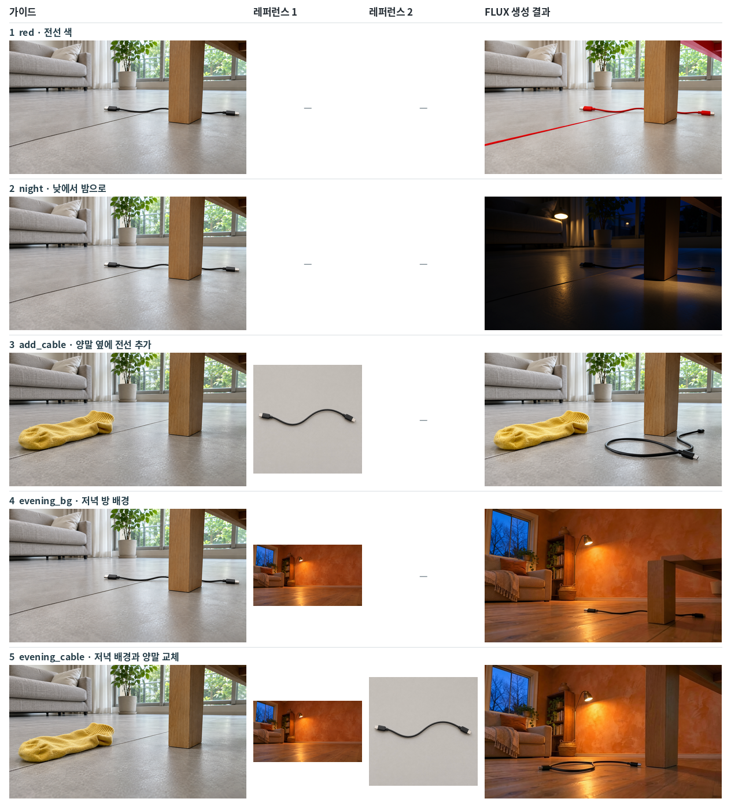

# vision-generation-boilerplate

A boilerplate for offline image editing with FLUX.2 klein 4B using a single Excel sheet to specify a guide image, up to two reference images, and a prompt for each edit

`vgen`은 엑셀 한 시트에 한 줄씩 적은 요청을 로컬 GPU에서 실행하는 이미지 편집 CLI입니다. 각 행에서 **가이드 이미지**는 편집할 원본입니다. **레퍼런스 이미지**는 필요에 따라 한 장이나 두 장을 지정합니다. 예를 들어 거실 원본에 저녁 방 사진과 전선 사진을 함께 넣고, 배경을 바꾸면서 양말을 전선으로 교체하도록 요청할 수 있습니다. 같은 가이드를 여러 행에 쓰면 각 편집은 그 원본에서 독립적으로 시작합니다.

## 설치

검증 환경은 Linux x86_64, Python 3.12.3, RTX 5060 Laptop GPU 8GB입니다. 저장소를 받은 뒤 프로젝트 루트에서 가상환경을 만들고 설치 도구부터 고정합니다.

```bash
git clone https://github.com/sirius-mhlee/vision-generation-boilerplate.git
cd vision-generation-boilerplate
python3.12 -m venv .venv
source .venv/bin/activate
python -m pip install -r requirements/bootstrap.lock
```

엑셀을 검사하고 계획을 만드는 데에는 기본 설치만 있으면 됩니다. 같은 가상환경에 GPU 패키지를 추가할 수 있습니다.

```bash
python -m pip install --no-build-isolation -r requirements/workbook.txt
```

이미지까지 생성하려면 CUDA 12.8 빌드를 사용할 수 있는 NVIDIA 드라이버와 GPU가 필요합니다. 다음 명령은 PyTorch 2.10.0+cu128, torchvision 0.25.0+cu128 및 추론에 필요한 전이 의존성을 검증한 버전으로 설치합니다. [패키지 버전과 설치 인덱스](requirements/linux-py312-cu128.lock) · [PyTorch 공식 CUDA 빌드](https://pytorch.org/get-started/previous-versions/)

```bash
python -m pip install --no-build-isolation -r requirements/linux-py312-cu128.lock -e '.[gpu]'
python -m pip check
```

## 로컬 모델 준비

이미 받은 FLUX.2 klein 4B의 Diffusers 모델은 `models/FLUX.2-klein-4B/`에 두거나 `vgen prepare --model-dir`에 기존 폴더를 지정합니다. 새로 받을 때는 인터넷이 연결된 환경에서 아래 명령을 한 번 실행합니다. [고정한 리비전의 모델 파일](https://huggingface.co/black-forest-labs/FLUX.2-klein-4B/tree/e7b7dc27f91deacad38e78976d1f2b499d76a294)

```bash
hf download black-forest-labs/FLUX.2-klein-4B \
  --revision e7b7dc27f91deacad38e78976d1f2b499d76a294 \
  --local-dir models/FLUX.2-klein-4B \
  --exclude 'flux-2-klein-4b.safetensors'
```

모델 폴더에 `model_index.json`과 `scheduler/`, `text_encoder/`, `tokenizer/`, `transformer/`, `vae/`가 있어야 합니다. 설치와 모델 준비가 끝나면 오프라인에서 생성·재개할 수 있습니다. 필수 모델 파일이 빠졌다면 오류에 표시된 로컬 경로에 파일을 복원하고 다시 실행하세요.

## 정식 CLI 사용 예시

배포 예제는 가이드 두 장과 레퍼런스 두 장으로 다섯 가지 편집을 만듭니다. 아래 예시는 프로젝트 루트에서 실행합니다.

### 1. 사진과 엑셀 준비

**편집** 시트의 첫 행은 A열부터 `번호`, `편집 ID`, `가이드 이미지`, `레퍼런스 이미지 1`, `레퍼런스 이미지 2`, `프롬프트` 순서입니다. `번호`에는 1 이상의 정수를 적습니다. 중간 번호를 건너뛰어도 됩니다. 시트에서 고유한 `편집 ID`는 결과 파일명과 작업별 시드를 정합니다. 이미지 칸에는 엑셀 파일을 기준으로 한 PNG 상대 경로를 적습니다. 레퍼런스 칸은 각각 비워 둘 수 있습니다. [예제 엑셀](examples/living-room/scenarios.xlsx)

`red`와 `night`는 가이드만, `add_cable`과 `evening_bg`는 레퍼런스 한 장을 함께 사용합니다. `evening_cable`은 **가이드 → 저녁 방 → 전선** 순서로 세 장을 한 번에 전달합니다. 프롬프트에는 저녁 방에서 어떤 배경을 가져오고 전선으로 무엇을 바꿀지 적습니다. [저녁 방](examples/living-room/refs/evening_room.png) · [검은 USB-C 전선](examples/living-room/refs/black_cable.png)

시트와 PNG를 검사하면 각 행의 번호, 편집 ID, 입력 경로가 표시됩니다.

```bash
vgen workbook examples/living-room/scenarios.xlsx
```

예제의 마지막 행은 두 레퍼런스를 모두 사용합니다.

```text
5번 evening_cable (엑셀 6행) | 가이드=guides/living01.png | 레퍼런스 1=refs/evening_room.png | 레퍼런스 2=refs/black_cable.png
```

### 2. 생성할 계획 확인

`prepare`는 시트와 PNG를 검사하고 실행 폴더에 `plan.json`을 저장합니다. 모델이나 GPU 없이 여러 계획을 미리 준비할 수 있습니다. 실험마다 `--out`에 다른 폴더를 지정하세요.

```bash
vgen prepare examples/living-room/scenarios.xlsx --out runs/living01
```

```text
편집 5행 × 반복 1회 = 예상 PNG 5장
저장 위치     runs/living01/images/r001/
계획 파일     runs/living01/plan.json
```

`vgen prepare <엑셀 경로> --out <실행 폴더>`에서 엑셀 경로와 `--out`은 필수입니다. 가이드·레퍼런스·프롬프트는 엑셀의 각 행에, 아래 옵션은 한 실행 전체에 적용합니다.

| 옵션 | 기본값 | 용도 |
|---|---|---|
| `--out` | 필수 | `plan.json`과 결과를 보관할 실행 폴더 |
| `--repeat` | `1` | 편집별 반복 횟수. 1 이상의 정수이며 5행을 2회 반복하면 10장입니다. |
| `--seed` | `42` | 작업별 시드를 정하는 기준 정수. 편집 ID와 반복 번호가 같으면 같은 기준 시드에서 같은 작업 시드를 얻습니다. |
| `--steps` | `4` | 편집 한 건의 노이즈 제거 횟수. 1 이상의 정수입니다. |
| `--max-edge` | `1024` | 가이드와 레퍼런스를 축소할 때 긴 변의 상한(16~1024 px). 최종 PNG는 가이드 원본 크기로 저장합니다. |
| `--model-dir` | `models/FLUX.2-klein-4B` | 추론에 사용할 로컬 모델 폴더. 상대 경로는 명령을 실행한 디렉터리 기준입니다. |

`prepare`는 가이드와 각 레퍼런스를 축소하고 16의 배수로 패딩했을 때 FLUX가 받을 크기를 확인합니다. 짧은 변은 64 px 이상, 긴 변은 짧은 변의 8배 이하여야 합니다. 예를 들어 거실 가이드에 `--max-edge 64`를 지정하면 64×48 px이 됩니다. 이 경우 계획을 저장하기 전에 해당 엑셀 셀과 경로를 알려 줍니다.

이번 버전은 `guidance_scale=1.0`, PNG 압축 레벨 0을 사용합니다. 저장된 계획의 옵션은 `generate`와 `resume`이 그대로 사용합니다.

`plan.json`의 `jobs` 배열에는 반복별로 엑셀 행 순서대로 작업이 들어갑니다.

| 항목 | 계획에서 확인할 내용 |
|---|---|
| `inputs` | 가이드부터 시작하는 전달 순서(`position`), 입력 PNG의 절대 경로와 SHA-256. 레퍼런스에는 엑셀 칸 번호(`reference_slot`)도 기록합니다. |
| `user_prompt`, `model_prompt` | 엑셀 원문과 모델에 보낼 문장. 2번 칸만 채운 행에는 두 번째 사진이 레퍼런스 2라고 명시합니다. |
| `seed`, `output_path` | 기준 시드·편집 ID·반복 번호로 정한 시드와 실행 폴더 기준 출력 경로. 예를 들어 첫 반복의 5번 편집은 `images/r001/evening_cable.png`입니다. |

계획 상단의 `model_dir`은 모델 폴더의 절대 경로이고 `generation`은 생성 옵션입니다. 생성 전에는 엑셀을 수정하고 같은 폴더에 다시 준비할 수 있습니다. 입력 검증과 새 계획 쓰기가 끝나면 `plan.json`을 한 번에 교체합니다. 실패하면 원인을 표시하고 이전 계획을 보존합니다.

### 3. 생성하고 결과 확인

준비한 실행 폴더를 지정합니다. 입력 PNG의 SHA-256을 확인하고 로컬 모델을 한 번 적재합니다. 각 작업은 `plan.json`에 저장된 프롬프트·시드와 입력 순서로 독립 실행됩니다. 엑셀을 나중에 고쳐도 이번 실행에는 준비할 당시의 지시가 적용됩니다.

```bash
vgen generate runs/living01
```

```text
성공 5장 · 실패 0건 · 저장 위치 runs/living01/images
```

```text
runs/living01/
├── plan.json          # 작업별 가이드, 선택 레퍼런스, 프롬프트, 시드, 출력 경로
├── run.json           # 계획 지문, 로컬 모델 파일별 SHA-256, 실행 환경
├── manifest.jsonl     # 작업별 성공·실패·복구 시작 기록과 입출력 지문
└── images/r001/
    ├── red.png
    ├── night.png
    ├── add_cable.png
    ├── evening_bg.png
    └── evening_cable.png
```

첫 추론 전에 `run.json`에 계획의 SHA-256, 모델 파일별 SHA-256, 패키지 버전, GPU와 생성 설정을 저장합니다. 매 작업 직전에 입력 지문을 다시 확인합니다. PNG 저장과 검증이 끝나면 `manifest.jsonl`에 성공 한 줄을 추가합니다. 한 건의 추론이 실패하면 오류를 기록하고 다음 작업을 계속하며, 실패가 있으면 CLI의 종료 코드는 1입니다. 입력 PNG가 계획과 달라지면 해당 경로를 표시하고 추론 전에 멈춥니다.



아래는 새 클론에서 배포 예제의 기준 시드 42로 생성한 결과입니다. 각 편집은 ID와 반복 번호로 정한 시드를 사용했습니다. RTX 5060 Laptop GPU 8GB에서 BF16, 순차 CPU 오프로딩, 4스텝으로 측정했습니다. PyTorch 2.10.0+cu128이 보고한 총 GPU 메모리는 7,705.8 MiB입니다. Diffusers 0.38.0에서 모델 파일의 지문을 계산한 후 파이프라인을 적재하는 데 0.47초가 걸렸습니다. 표의 시간은 장당 추론부터 PNG 저장까지이고, 메모리는 PyTorch의 CUDA 최대 할당량과 예약량입니다.

| 편집 ID | 결과에서 확인한 변화 | 시간 | 할당 / 예약 (MiB) |
|---|---|---:|---:|
| `red` | 전선과 단자 하우징이 빨개졌습니다. 바닥의 대각선 줄눈과 오른쪽 위 책상 모서리까지 빨개졌습니다. | 12.88초 | 1,393 / 1,468 |
| `night` | 창밖이 어두워지고 소파 쪽에 등이 켜졌습니다. 전선은 책상 다리 양쪽에 남았습니다. | 12.33초 | 1,393 / 1,468 |
| `add_cable` | 노란 양말 오른쪽에 검은 전선이 놓였습니다. 참고 사진의 완만한 S자보다 큰 고리가 생겼습니다. | 21.08초 | 1,560 / 1,874 |
| `evening_bg` | 주황빛 벽과 조명, 나무 바닥이 반영됐습니다. 다리는 전선 가운데를 계속 가리지만 책상 상판의 높이와 전선 위치가 달라졌습니다. | 17.05초 | 1,394 / 1,590 |
| `evening_cable` | 저녁 배경에서 양말이 사라지고 두 단자가 보이는 검은 전선이 생겼습니다. 오른쪽 다리는 남았고 바닥은 타일에서 마루로 바뀌었습니다. | 26.93초 | 1,561 / 2,386 |

가이드는 1024×576, 전선 레퍼런스는 1024×1024, 방 레퍼런스는 1024×576으로 처리했습니다. 최종 다섯 장은 가이드 원본과 같은 **1672×941, 압축 레벨 0의 PNG**입니다. 이 실행의 계획·모델 파일 18개·입력·출력 지문을 대조했고, 실행 중 IPv4·IPv6 연결 호출은 0회였습니다.

### 4. 중단된 생성 이어가기

Ctrl+C로 중단했다면 터미널에 표시되는 명령을 따르세요. 최초 실행이 기록된 뒤에는 같은 폴더에 `resume`을 실행합니다. 추론 도중 중단된 편집은 저장된 시드와 원본 입력으로 첫 스텝부터 다시 시작합니다.

```bash
vgen resume runs/living01
```

먼저 `plan.json`이 최초 실행 때 저장한 SHA-256과 일치하는지 확인합니다. 작업별로 최근 기록이 성공이고 PNG와 지문이 일치하면 건너뜁니다. 남은 작업이 있으면 해당 입력 사진과 최초 실행의 모델 파일 목록·SHA-256을 대조한 뒤 추론합니다. 파일이 달라졌다면 표시된 경로의 원본을 복원하고 같은 명령을 다시 실행하세요. 모든 PNG가 유효하면 GPU나 모델 파일 없이도 완료 수와 저장 위치를 확인할 수 있습니다.

예제에서 첫 결과인 `red.png`를 저장하고 `night` 추론 중 중단했을 때의 출력입니다. 처음 재개하면 네 장을 만들고, 완료 후 같은 명령을 실행하면 다섯 장의 상태만 확인합니다.

```text
완료 PNG 5장 · 기존 1장 유지 · 이번 생성 4장 · 실패 0건 · 저장 위치 runs/living01/images
완료 PNG 5장 · 기존 5장 유지 · 이번 생성 0장 · 실패 0건 · 저장 위치 runs/living01/images
```

#### PNG 한 장 복구하기

예를 들어 다섯 장 중 `images/r001/evening_cable.png`가 사라지거나 다른 PNG로 바뀌면, 같은 실행 폴더에 `vgen resume`을 실행하세요. 해당 반복의 가이드 → 저녁 방 → 전선 순서와 저장된 시드로 한 장을 다시 만듭니다. 나머지 네 장은 내용과 수정 시각을 유지합니다. PNG가 저장됐어도 해당 작업의 성공 기록을 쓰기 전에 프로세스가 종료됐다면 같은 방식으로 복구합니다.

기존 성공 결과를 복구할 때는 `manifest.jsonl`에 먼저 `repairing`을 기록합니다. 새 PNG를 검사하고 최종 위치에 저장한 뒤 `success`를 추가합니다. 두 기록 사이에 중단되면 같은 시드가 이전과 똑같은 PNG를 만들었더라도 다음 재개에서 해당 편집을 다시 실행합니다.

## 내 장면에 맞게 바꾸기

예제 폴더를 복사한 뒤 엑셀과 PNG를 바꾸세요. 이후 `prepare`에 복사한 엑셀과 새 실행 폴더를 지정합니다. `inputs/`, `models/`, `runs/`는 Git에서 제외됩니다.

```bash
mkdir -p inputs
cp -r examples/living-room inputs/my-room
vgen prepare inputs/my-room/scenarios.xlsx --out runs/my-room
```

| 만들고 싶은 결과 | 엑셀이나 명령에서 바꿀 부분 | 예상 결과 |
|---|---|---|
| 슬리퍼 색만 바꾸기 | 슬리퍼가 놓인 가이드 한 장과 “슬리퍼를 노란색으로 바꿔 주세요”라는 편집 한 행을 적습니다. | 1회에 PNG 1장 |
| 다리 뒤에 가려진 전선 비교 | 원하는 가림이 있는 가이드에 색과 형태 지시를 한 행씩 적습니다. | 1회에 같은 원본에서 PNG 2장 |
| 여러 바닥에서 대량 변형 | 가이드 10장에 색·형태·조명 편집을 각각 적용하려면 가이드마다 3행씩, 서로 다른 편집 ID로 총 30행을 적습니다. | 1회에 30장, `--repeat 100`이면 3,000장 |

가림 관계나 물체 위치가 중요할 때는 그 배치가 이미 보이는 가이드를 사용하세요. 기존 전선을 책상 다리 뒤로 옮기는 지시는 두 조건 모두 실패했고, 이미 가려진 전선은 원래 가림을 유지하면서 피복 색이나 굴곡을 바꿀 수 있었습니다. [초기 실험 결과와 비교 이미지](docs/IMPLEMENTATION_STEPS.md)

## 테스트

프로젝트 루트의 가상환경에서 실행합니다. 단위 테스트는 GPU 없이 동작합니다. NumPy를 설치하면 추론 전처리와 결과 PNG 크기 검사도 실행합니다.

```bash
python -m unittest discover -s tests -v
```
