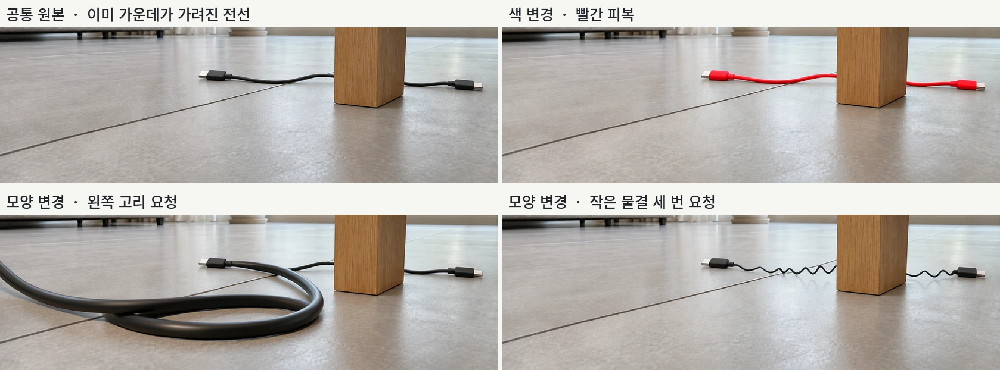
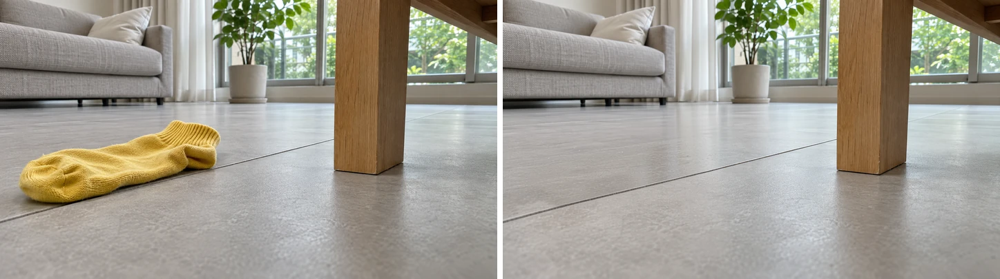
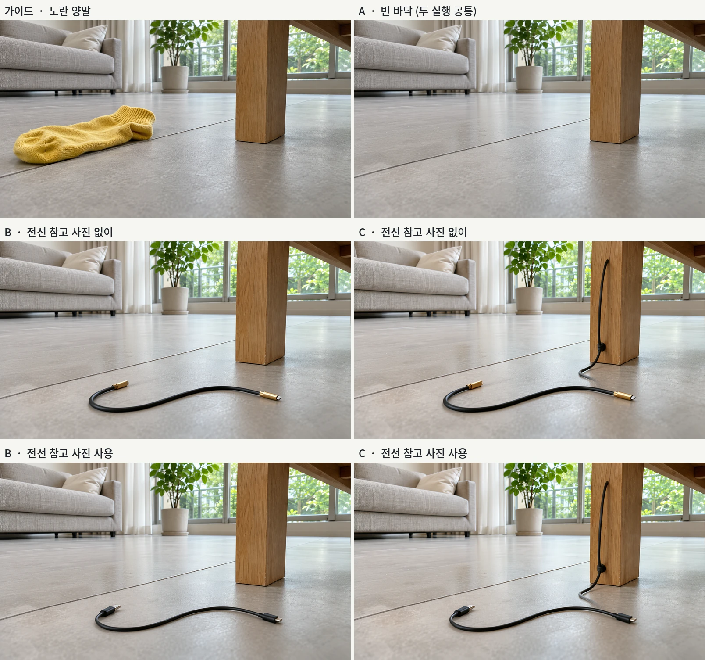
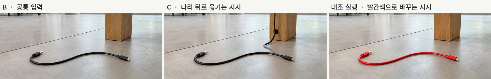

# vision-generation-boilerplate

A boilerplate for generating independent image variations from a single guide photo per scene using FLUX.2 klein 4B and editing instructions defined in Excel, all offline.

`vgen`은 장면마다 가이드 사진 한 장을 두고, 엑셀의 편집 지시마다 그 원본을 다시 읽어 PNG 한 장을 만드는 로컬 CLI를 목표로 합니다. 같은 낮 거실에서 빨간 전선, 물결 모양 전선, 마룻바닥, 야간 조명을 각각 요청하면 원본에서 출발한 결과가 네 장 생깁니다. 물체 배치와 가림이 중요할 때는 그 상태가 보이는 사진을 가이드로 준비합니다.

| 편집 대상 | 거실 가이드에서 확인한 범위 |
|---|---|
| 물체 색 | 다리 양옆 전선을 빨갛게 바꾸고 두 단자와 가운데 가림을 유지했습니다. |
| 물체 형태 | 고리와 물결을 만들었습니다. 전선의 굵기, 굴곡 수, 왼쪽 구간만 바꾸는 지시는 일부 벗어났습니다. |
| 주변 환경 | 바닥 재질 변경을 검증할 예정입니다. 전선과 가구 배치가 유지되는지도 함께 확인합니다. |
| 낮·밤과 조명 | 낮 거실을 밤으로 바꾸는 예시를 검증할 예정입니다. 창밖과 실내 조명, 전선의 식별 여부를 확인합니다. |

> **현재 실행할 수 있는 것은 단일 편집 파일럿입니다.** 아래 가이드로 색과 형태를 시험할 수 있습니다. 엑셀을 받는 `vgen prepare`, `generate`, `resume`은 후속 개발 단계입니다. [단계별 구현 계획](docs/IMPLEMENTATION_STEPS.md)

## 실행 환경과 최초 설치

아래 파일럿은 Linux, Python 3.12.3, RTX 5060 Laptop GPU에서 실행했습니다. PyTorch 2.10.0의 CUDA 12.8 빌드와 torchvision 0.25.0을 먼저 설치한 뒤 같은 가상환경에 Diffusers·Transformers와 모델 로딩에 필요한 패키지를 설치합니다. 이미 프로젝트와 `.venv`가 있다면 프로젝트 루트에서 가상환경 활성화부터 시작합니다. [PyTorch 공식 설치 조합](https://pytorch.org/get-started/previous-versions/)

```bash
git clone https://github.com/sirius-mhlee/vision-generation-boilerplate.git
cd vision-generation-boilerplate
python3.12 -m venv .venv
source .venv/bin/activate
python -m pip install torch==2.10.0 torchvision==0.25.0 --index-url https://download.pytorch.org/whl/cu128
python -m pip install -r requirements/pilot.txt
python -m pip check
```

모델은 인터넷이 되는 컴퓨터에서 한 번 준비합니다. 설치한 `huggingface-hub` 0.36.2의 `hf download`로 아래 리비전을 받습니다. 이미 받아 둔 모델은 그대로 사용하며, 다른 컴퓨터에서 받았다면 폴더를 복사하고 그 경로를 `--model-dir`에 지정합니다. [모델 파일 목록](https://huggingface.co/black-forest-labs/FLUX.2-klein-4B/tree/e7b7dc27f91deacad38e78976d1f2b499d76a294) · [Hugging Face 다운로드 안내](https://huggingface.co/docs/huggingface_hub/en/guides/cli#download-a-specific-revision)

```bash
hf download black-forest-labs/FLUX.2-klein-4B \
  --revision e7b7dc27f91deacad38e78976d1f2b499d76a294 \
  --local-dir models/FLUX.2-klein-4B \
  --exclude 'flux-2-klein-4b.safetensors'
```

`models/FLUX.2-klein-4B/` 아래에 `model_index.json`과 `scheduler/`, `text_encoder/`, `tokenizer/`, `transformer/`, `vae/`가 있어야 합니다. 위 명령은 따로 배포하는 단일 파일 가중치의 중복 다운로드를 생략합니다. [공식 모델 카드](https://huggingface.co/black-forest-labs/FLUX.2-klein-4B)

## 이미 가려진 전선의 색과 모양 바꾸기

빈 바닥 A와 USB-C 참고 사진을 사용해 ImageGen으로 가림이 있는 원본 한 장을 만들었습니다. 이 사진에서 검은 선은 책상 다리 왼쪽 테두리에서 사라지고 오른쪽 테두리에서 다시 보이며, 두 은색 단자가 모두 바닥에 놓여 있습니다. 아래 세 편집은 각각 이 원본 한 장을 로컬 FLUX.2 klein 4B에 입력한 결과입니다. [공통 원본 PNG](pilot/guides/living01_cable_behind.png)



| 한글 편집 지시의 의도 | 실제 결과 | 추론부터 저장까지 |
|---|---|---:|
| 검은 피복을 빨갛게 바꾸기 | 다리 양옆의 피복과 단자 하우징이 모두 빨갛게 바뀌었습니다. 은색 팁, 바닥 위 경로, 가운데 가림이 유지됐습니다. | 13.07초 |
| 왼쪽 구간에 둥근 고리 하나 만들기 | 왼쪽에 고리가 생기고 오른쪽 단자가 보입니다. 고리는 원래 전선보다 훨씬 굵고 화면 왼쪽 경계까지 커졌습니다. | 13.12초 |
| 왼쪽에 같은 굵기로 작은 물결 세 번 만들기 | 양끝과 가운데 가림을 유지하며 물결 모양이 생겼습니다. 왼쪽의 굴곡 수가 세 번을 넘었고 오른쪽 구간도 함께 휘었습니다. | 13.05초 |

세 실행 모두 시드 42, 4스텝, 처리 크기 1024×576이며, `metrics.json`에 기록된 입력 파일의 SHA-256이 일치합니다. 결과 원본은 각 실행 폴더의 `A.png`이며 크기는 모두 1672×941입니다.

프로젝트 루트에서 아래 명령을 실행합니다. 각 명령은 같은 가이드 파일을 다시 읽습니다. 이미 결과 폴더가 있으면 `--out`에 새 경로를 지정합니다.

```bash
guide_img=pilot/guides/living01_cable_behind.png

.venv/bin/python scripts/pilot_a.py --guide "$guide_img" --seed 42 \
  --prompt '검은색 케이블의 피복 전체를 선명한 빨간색으로 바꿔 주세요. 케이블의 위치와 모양은 그대로 두세요.' \
  --out runs/pilot-occluded-color

.venv/bin/python scripts/pilot_a.py --guide "$guide_img" --seed 42 \
  --prompt '사진 왼쪽에 보이는 검은 케이블의 중간을 바닥 위에서 둥근 고리 하나로 말아 주세요. 두 은색 단자와 오른쪽에 보이는 선은 현재 자리에 두세요.' \
  --out runs/pilot-occluded-shape

.venv/bin/python scripts/pilot_a.py --guide "$guide_img" --seed 42 \
  --prompt '왼쪽 은색 단자와 나무 다리 사이의 검은 전선을 같은 얇은 굵기로, 작은 물결이 세 번 이어지도록 구부려 주세요. 양쪽 단자와 오른쪽 전선은 그대로 두세요.' \
  --out runs/pilot-occluded-wave
```

<details>
<summary>가림 원본을 만든 ImageGen 프롬프트</summary>

Edit the first photograph, using the second only for the appearance of the black USB-C cable. Keep the same low camera angle, landscape framing, furniture, wood leg, gray tile and light. Lay exactly one unplugged black USB-C cable flat across the tiles BEHIND the large wooden table leg at right. Its left connector is completely visible on the floor near the middle of the frame, its left lead runs gently rightward and disappears behind the lower LEFT silhouette edge of the wooden leg a little ABOVE its contact with the floor. Its right lead emerges from behind the lower RIGHT silhouette edge and continues across the floor to a clearly visible second silver-tipped connector near the right side, with a generous margin inside the frame. Give both exposed sections enough length to see and edit. The foreground wooden leg occludes the whole central span. The front and side faces of the wood are flawlessly intact, clean and completely bare from top to bottom. The two visible leads never touch the face of the wood or cross the floor in front of it. Two visible connectors total. Photorealistic, no text, no graphics.

</details>

## 정식 CLI 사용 예시

아래는 개발 예정인 세 명령으로 거실 가이드 한 장에서 독립적인 PNG 네 장을 만드는 예시입니다.

### 1. 사진과 엑셀 준비

`pilot/scenarios.xlsx`를 직접 작성하고 사진 경로는 엑셀 폴더 기준으로 적습니다. 이 예시의 가이드는 프로젝트에 포함된 `pilot/guides/living01_cable_behind.png`입니다. 직접 찍은 JPG나 PNG도 사용할 수 있습니다.

**장면** 시트에는 장면 ID와 가이드 사진을 적습니다. 공간·가구, 바닥·이음새, 조명은 원본을 설명하고 싶을 때 쓰는 선택 열입니다. 바꾸고 싶은 내용은 편집 시트에 적습니다.

| 장면 ID | 가이드 사진 |
|---|---|
| living01 | guides/living01_cable_behind.png |

**편집** 시트의 한 행은 모든 장면에 적용할 독립적인 요청 한 건입니다. ID는 사용자가 정합니다. 아래 네 행에서 모델에 전달되는 이미지는 모두 위의 가이드 한 장입니다.

| 편집 ID | 편집 지시 |
|---|---|
| red | 검은 전선의 피복을 빨간색으로 바꾸고 위치와 모양을 유지해 주세요. |
| wave | 왼쪽에 보이는 전선을 작은 물결 모양으로 구부리고 단자의 위치를 유지해 주세요. |
| floor | 회색 타일 바닥을 밝은 나무 마루로 바꾸고 전선과 책상은 같은 자리에 두세요. |
| night | 같은 거실을 밤으로 바꿔 주세요. 창밖은 어둡고 실내등 아래 전선이 보이게 해 주세요. |

예를 들어 `night`가 읽는 원본에는 검은 전선과 타일이 보입니다. 밤에도 빨간 전선을 원하면 해당 행의 지시에 두 조건을 함께 적습니다.

### 2. 생성할 계획 확인

```bash
vgen prepare pilot/scenarios.xlsx \
  --out runs/living01 --repeat 1 --seed 42 \
  --model-dir "$PWD/models/FLUX.2-klein-4B"
```

```text
장면 1개 × 편집 4개 × 반복 1회 = 예상 PNG 4장
모든 작업의 입력  guides/living01_cable_behind.png
저장 위치          runs/living01/images/living01/r001/
편집별 출력        red.png  wave.png  floor.png  night.png
```

`prepare`는 GPU와 가중치 없이 엑셀과 사진을 확인합니다. `plan.json`에서 작업별 가이드 경로와 SHA-256, 최종 한글 지시, 시드, 출력 경로를 확인합니다. 생성 전에는 엑셀을 수정하고 같은 폴더에서 다시 준비할 수 있습니다. 새 계획의 검사가 끝나면 이전 계획을 교체합니다.

### 3. 생성하고 결과 확인

```bash
vgen generate runs/living01
```

```text
runs/living01/
├── plan.json          # 작업별 가이드, 지시, 시드, 출력 경로
├── run.json           # 계획 지문, 로컬 모델 파일별 SHA-256, 실행 환경
├── manifest.jsonl     # 작업별 성공·실패, 사용한 가이드와 출력의 지문
└── images/living01/r001/
    ├── red.png
    ├── wave.png
    ├── floor.png
    └── night.png
```

각 PNG를 가이드와 나란히 놓고 요청한 변화와 보존할 부분을 함께 봅니다. 예를 들어 `floor.png`에서는 바닥 재질과 전선의 양끝을, `night.png`에서는 창밖과 실내 조명, 책상 다리 뒤의 가림을 확인합니다.

### 4. 중단된 생성 이어가기

```bash
vgen resume runs/living01
```

성공 기록과 PNG 지문이 일치하는 작업은 건너뜁니다. 예를 들어 네 장을 만든 뒤 `floor.png`만 손상됐다면 원본 가이드에서 `floor` 한 건만 복구합니다. PNG를 저장한 직후 성공 기록을 남기기 전에 중단된 작업도 다시 만듭니다. 추론이 남으면 가이드와 로컬 모델의 지문을 대조하고, 모두 마친 실행에서는 이미지 수와 저장 위치를 표시합니다.

## 내 장면에 맞게 바꾸기

| 만들고 싶은 결과 | 엑셀이나 명령에서 바꿀 부분 | 예상 결과 |
|---|---|---|
| 슬리퍼 색만 바꾸기 | 슬리퍼가 놓인 가이드 한 장과 “슬리퍼를 노란색으로 바꿔 주세요”라는 편집 한 행을 적습니다. | 1회에 PNG 1장 |
| 다리 뒤에 가려진 전선 비교 | 원하는 가림이 있는 가이드에 색과 형태 지시를 한 행씩 적습니다. | 1회에 같은 원본에서 PNG 2장 |
| 여러 바닥에서 대량 변형 | 바닥이 다른 가이드 10장을 장면 시트에 적고 공통 편집 3개를 작성합니다. | 1회에 30장, `--repeat 100`이면 3,000장 |

## 초기 파일럿 기록

가이드 선택과 편집 범위를 정할 때 실행한 실험입니다. 아래 A·B·C 표기는 당시 연속 편집 파일럿의 파일 이름입니다.

### 가이드에서 양말 지우기

프로젝트에 포함된 거실 사진은 ImageGen으로 만든 합성 가이드입니다. 프로젝트 루트에서 아래 명령을 실행하면 로컬 FLUX가 왼쪽 앞의 노란 양말을 지웁니다. 편집 지시는 “노란 양말만 사진에서 깨끗하게 지워 주세요. 사진의 나머지 부분은 그대로 두세요.”입니다.

```bash
.venv/bin/python scripts/pilot_a.py
```

결과는 `runs/pilot-a/A.png`, 프롬프트·시드·버전·측정값은 같은 폴더의 `metrics.json`에 저장됩니다. 다시 실행할 때는 `--out runs/pilot-a-repeat`를 붙여 새 폴더에 저장합니다. 스크립트는 `HF_HUB_OFFLINE=1`과 `local_files_only=True`를 사용합니다.



왼쪽이 입력, 오른쪽이 결과 A입니다. 양말이 있던 자리를 가로질러 대각선 줄눈이 이어지고, 오른쪽 책상 다리의 바닥 접점과 낮은 카메라 구도가 유지됩니다.

RTX 5060 Laptop GPU 8GB에서 BF16, 순차 CPU 오프로딩, 시드 42, 4스텝, `guidance_scale=1.0`으로 측정했습니다. 모델 적재 시간은 같은 모델 파일을 앞서 읽은 상태에서 측정한 값입니다.

| 가이드 → 모델 처리 → PNG 저장 | 모델 적재 | 추론 시작부터 PNG 저장까지 | PyTorch 최대 할당 / 최대 예약 GPU 메모리 |
|---|---:|---:|---:|
| 1672×941 → 1024×576 → 1672×941 | 0.71초 | 14.07초 | 1,393 / 1,468 MiB |

같은 시드와 해상도에서 한글 지시 세 가지를 비교했습니다. 긴 지시에서는 양말이 남았고, 타일 바닥을 묘사한 지시에서는 줄눈이 하나 더 생겼습니다. 위의 두 문장을 기본값으로 정한 뒤 같은 환경에서 다시 실행해 PNG의 SHA-256이 일치하는 것을 확인했습니다. 재실행 중 IPv4·IPv6 연결 요청은 0건이었습니다.

### 전선을 놓고 책상 다리 뒤로 옮기는 연속 편집

프로젝트 루트에서 아래 두 명령을 실행하면 조건별 폴더에 각각 `A.png`, `B.png`, `C.png`와 `metrics.json`이 생깁니다. 한 번 실행할 때 로컬 모델을 한 번 적재합니다. 기존 결과를 보관한 채 다시 시도하려면 `--out`에 새 폴더 이름을 지정합니다.

```bash
.venv/bin/python scripts/pilot_abc.py --out runs/pilot-abc-no-ref
.venv/bin/python scripts/pilot_abc.py --reference pilot/refs/black_cable.jpg --out runs/pilot-abc-with-ref
```

| 편집 | 참고 사진 없이 실행 | 참고 사진을 넣어 실행 |
|---|---|---|
| A · 양말 지우기 | 거실 가이드 | 같은 거실 가이드 |
| B · 전선 놓기 | 이 실행의 A | 이 실행의 A, 전선 참고 사진 순서 |
| C · 전선 가운데 가리기 | 이 실행의 B | 이 실행의 B |

`metrics.json`의 `edits`에는 실제로 읽은 파일의 순서와 SHA-256, 편집 지시, 시드, 입력·출력 크기, 저장한 PNG의 SHA-256과 단계별 GPU 측정값이 기록됩니다. 전선 참고 사진은 검은 피복과 은색 USB-C 단자가 양끝에 보이도록 ImageGen으로 만든 정사각형 이미지입니다. [전선 참고 사진](pilot/refs/black_cable.jpg)

<details>
<summary>전선 참고 사진을 생성한 프롬프트</summary>

Use case: product-mockup. A single square, photorealistic reference photograph of one short black USB-C to USB-C charging cable on a plain light warm gray matte tabletop. Entire cable fully in frame, left to right, forming one loose shallow S curve, uncoiled, no crossings. Both identical ends plainly visible, each with a small black molded housing and a short silver USB-C tip. Slender smooth round matte black rubber jacket with soft highlights. View from above, neutral soft daylight, subtle contact shadow, generous empty margin, sharp enough to identify each tip. Only the cable and the neutral surface. No text, no marks, no logos or other objects. This photo will be an appearance reference for a separate image edit.

</details>

#### GPU 실행 결과



두 실행의 A는 1단계 PNG와 파일 지문이 일치합니다. 두 B 모두 줄눈 옆에 검은 전선 한 가닥과 양끝이 보입니다. 참고 사진을 쓴 B에서는 검은 단자 하우징과 은색 팁이 보이고, 참고 사진을 생략한 B에서는 단자가 금색입니다. **C는 두 조건 모두 가림 기준 미통과입니다.** 앞쪽의 전선이 그대로 남았고, 모델은 나무 다리 앞면에 검은 선을 하나 더 그렸습니다.

RTX 5060 Laptop GPU 8GB에서 BF16, 순차 CPU 오프로딩, 시드 42, 4스텝으로 실행했습니다. 거실은 1024×576, 전선 참고 사진은 1024×1024로 처리했고, 여섯 PNG 모두 가이드와 같은 1672×941입니다. 시간은 추론 시작부터 PNG 저장까지입니다. 메모리는 각 추론 직전에 집계를 초기화한 PyTorch 최대 할당 / 최대 예약 값입니다.

| B의 참고 사진 | 모델 적재 | A | B | C | A·C 최대 메모리 | B 최대 메모리 |
|---|---:|---:|---:|---:|---:|---:|
| 없음 | 0.46초 | 13.09초 | 12.69초 | 12.65초 | 1,393 / 1,468 MiB | 1,393 / 1,468 MiB |
| 사용 | 0.47초 | 13.13초 | 21.49초 | 12.69초 | 1,393 / 1,468 MiB | 1,560 / 1,874 MiB |

#### C가 B와 비슷하게 보일 때

참고 사진을 사용한 실행에서 C의 지시만 바꿔, 같은 B와 같은 시드로 전선 색상을 바꾸는 대조 실험을 했습니다.

```bash
.venv/bin/python scripts/pilot_abc.py --reference pilot/refs/black_cable.jpg \
  --prompt-c '검은색 케이블의 피복 전체를 선명한 빨간색으로 바꿔 주세요. 케이블의 위치와 모양은 그대로 두세요.' \
  --out runs/pilot-abc-control-red
```



두 실행의 `edits.B.output_sha256`과 `edits.C.input_sha256[0]`가 모두 일치했습니다. 색 변경에서는 전선의 피복이 빨갛게 바뀌었고, 가림 지시에서는 가운데가 계속 보였습니다. 시드를 바꾼 추가 실험에서도 전선의 위치와 형상은 달라졌지만, 같은 다리 뒤에 가운데만 가리고 두 단자를 보존하는 결과는 확인하지 못했습니다.
